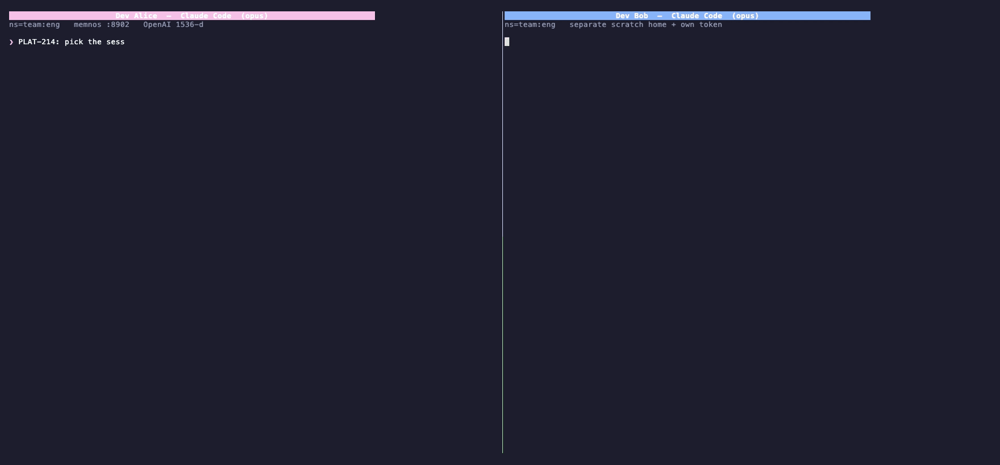
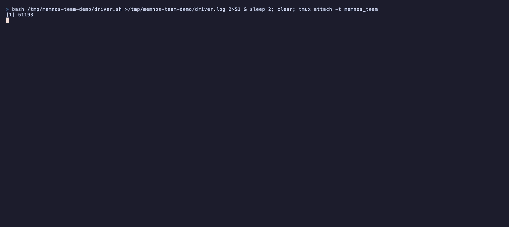

# memnos

[](https://github.com/thameema/memnos/actions/workflows/ci.yml)
[](LICENSE)
[](pyproject.toml)
[](#)
[](#)
[](benchmarks/README.md)
[](#benchmarks-and-how-we-report-them)
[](https://pypi.org/project/memnos/)

**Git-aware, bi-temporal memory for AI coding agents — shared across Claude Code, Cursor, Codex & Windsurf on a single Postgres.**

```bash
uv tool install memnos
memnos setup && memnos start   # zero-Docker embedded Postgres + pgvector (~25 MB)
memnos init                    # hydrate CLAUDE.md rules + 90d git history in <5s
memnos agent-setup all         # wire hooks + MCP into Claude Code, Cursor, Codex, Windsurf
```

### Why Developers Use `memnos` Daily

- **Git-Anchored Provenance (`code_anchors`)** — Links decisions and fixes to exact `(file_path, blob_sha, identifiers)`. When a referenced symbol changes or a file is deleted, recall automatically warns `(code changed: <file> modified since recorded)` instead of feeding stale advice to your agent.
- **Bi-Temporal Supersession** — When your architecture or config changes, `memnos` closes out (`valid_to`) the old fact instead of piling up contradictory notes. Zero LLM calls on the recall path (`<50ms` hybrid RRF + ONNX cross-encoder rerank).
- **Structured Fix Memory (`memnos fix` / `record_fix`)** — Capture `Symptom / Cause / Fix / Verify` debugging solutions that automatically receive a bounded rank boost when a future session hits a matching stack trace or error.
- **5-Second Cold-Start Repo Hydration (`memnos init`)** — Ingests `CLAUDE.md` / `AGENTS.md` / `.cursorrules` as verbatim pinned constraints and your last 90 days of `git log` commits with zero LLM cost.
- **Multi-Agent Coordination & Auditable Recall (`memnos explain`)** — Built-in agent sessions, pub/sub channels, work-item leases, XML-escaped `<memnos:peer_memory>` untrusted data envelopes for cross-agent safety, and `memnos explain` to inspect every pinned constraint, score, and latency stage injected into your prompt.

| Capability | `CLAUDE.md` / `.cursorrules` | Generic Vector Memory (`mem0` / `Supermemory`) | **memnos** |
| :--- | :--- | :--- | :--- |
| **Setup & Infra** | Manual markdown file | Cloud API or multi-DB stack (Vector + Graph) | **1 command** (`uv tool install memnos`, embedded PG) |
| **When Facts Change** | Manual edits or stale rules | Returns both old & new facts as equals | **Bi-temporal supersession** (`valid_to` + stale-turn demotion) |
| **When Code Changes** | Silently drifts from code | No git or symbol awareness | **`code_anchors` (`blob_sha` + symbol diff drift alerts)** |
| **Query-Time LLM Cost** | $0 (loads entire file every turn) | Often requires LLM rerank/summarization | **$0 / 0 LLM calls** (hybrid vector+BM25 + local ONNX rerank) |
| **Multi-Agent Bus** | None | None | **Sessions, pub/sub channels, inbox, leases & peer envelopes** |


*It doesn't just remember — it knows what's true **now**: when a new fact contradicts an
old one, bi-temporal supersession closes the old fact out, and recall shows the transition.*

---

## Your AI remembers your repo. memnos remembers your team.

CLAUDE.md, Cursor rules, native model memory — all genuinely useful, and all the same
shape: **local and per-developer.** They sit on one machine, scoped to one repo or one
person's chat history. The knowledge that actually gets lost is *between* developers: the
decision a teammate made three sprints ago and why, the constraint nobody wrote down. That
never reaches the next engineer's agent.

memnos is one shared, governed memory the whole team's agents read and write — so a fact
one developer's agent learns is recallable by everyone else's, correctly attributed.



*Two **separate** Claude Code agents — different processes, different tokens, same
namespace (`ns=team:eng`). Alice's agent decides an auth approach; Bob's fresh agent (which
never saw her session) recalls it attributed **`by dev-alice`** and adds a constraint;
Alice's next turn picks up Bob's constraint, attributed **`by dev-bob`**. Bidirectional
shared memory across two real agents — server-stamped authorship (clients can't spoof it),
on your own Postgres, no LLM at recall time.*

The same proof at the CLI level, two `memnos` sessions on one namespace:



*Dev Bob's `recall` returns the decision Dev Alice stored, attributed `by dev-alice` — one
governed namespace, attribution stamped by the server, not the payload.*

**How memory gets captured is honest about its limits:** deterministic both-sides on Claude
Code (lifecycle hooks) and on any base-URL-configurable client via `memnos proxy`; MCP
capture is discretionary (the model chooses when to call the tools); ChatGPT and Claude
Desktop can't be cleanly auto-captured (no base-URL override, no cert MITM) — MCP is the
path there. Details in [Integrations](#integrations).

The concept (the gap, and why attribution must be server-stamped) is in
[`docs/team-memory.md`](docs/team-memory.md); standing up one shared host with a scoped
token per developer is in [`docs/guides/team.md`](docs/guides/team.md).

---

## Quickstart

Install into an isolated environment (`uv` recommended; `pipx` works too — don't
`pip install` into your system Python):

```bash
uv tool install memnos        # no uv?  brew install uv   or
                              #         curl -LsSf https://astral.sh/uv/install.sh | sh

memnos setup                  # ← zero external dependencies by default: downloads embedded
                              #   PG + pgvector (~20-30 MB, macOS arm64 / Linux x86_64 /
                              #   Windows x86_64) — no Docker, no brew, no apt
                              # or: memnos setup --external (connect to YOUR existing Postgres)
                              # or: memnos setup --docker   (spin up a pgvector container)
memnos start                  # background server on http://127.0.0.1:8900
memnos app                    # launch native MEMNOS Desktop workspace
```

Bare `memnos setup` downloads a pre-built PostgreSQL 16 + pgvector binary into
`~/.memnos/embedded_pg/` on first run (same as the explicit `memnos setup --embedded` —
the flag still works, it's just the default now). No Docker, no `brew`, no `apt` — just
`uv tool install` and you're done. `memnos start` auto-restarts the embedded PG on every boot.
On a platform without an embedded build (anything other than the three above), it falls
back to the original interactive wizard automatically — `--docker`/`--external` always work
everywhere regardless.

Operate it like any daemon: `memnos status` / `stop` / `restart`; `memnos serve` runs in
the foreground for systemd/launchd/Docker; `memnos upgrade` updates in place;
`memnos autostart` installs a login service so the server survives reboots.

During first-time setup (`memnos setup`), `memnos` asks you in plain English to choose one
embedding mode before answering any queries (no silent background downloads or half-working
state):

1. **Use my own OpenAI key** — fastest setup, nothing to download; memory and query text is
   sent to OpenAI (`text-embedding-3-small`, 1536-d, key stored AES-256-GCM encrypted in Vault).
2. **Run it on this computer** — private and free (nothing leaves your machine); requires a
   one-time download of **~1 GB (~930 MB)** for the local multilingual neural embedding
   (`intfloat/multilingual-e5-small`, 384-d) and cross-encoder reranker
   (`cross-encoder/mmarco-mMiniLMv2-L12-H384-v1`) models (in CI/headless mode, confirm
   explicitly via `memnos setup embeddings --local --yes` or `memnos models pull --yes`).

For fact extraction without OpenAI, set `MEMNOS_EXTRACT_BASE_URL` to any OpenAI-compatible
endpoint (Ollama / vLLM / LM Studio). You can switch between OpenAI and local embeddings
anytime with `memnos migrate-embeddings`, which (like `memnos upgrade` and `memnos backup`)
automatically takes and verifies a full `0600` PostgreSQL backup (`pg_dump` + `pg_restore --list`)
before touching data. Embedded PostgreSQL installs (`memnos setup`) bundle `pg_dump` and
`pg_restore` automatically under `~/.memnos/embedded_pg`; for Docker or external PostgreSQL
hosts without client tools on `PATH`, install `libpq` / `postgresql-client` (or point
`MEMNOS_PG_BIN` at your PostgreSQL `bin/` folder).

Extraction depends on who is speaking. Every turn is stored verbatim and stays searchable.
From your own messages, memnos extracts decisions, preferences, rules, plans and personal
facts. From the assistant's replies, it keeps only decisions, concrete outcomes,
identifiers (PR/issue numbers, versions, SHAs, hosts) and explicit state changes, capped
per reply by `MEMNOS_ASSISTANT_FACT_CAP` (default 6). A fact the assistant repeats is not
counted as corroboration. To store facts about you under your name rather than a generic
"user", set `MEMNOS_USER_NAME`, for example `MEMNOS_USER_NAME="Ada Lovelace"`.

Full walkthrough: [`QUICKSTART.md`](QUICKSTART.md) · Windows:
[`docs/guides/windows.md`](docs/guides/windows.md) · everything else: `memnos --help`.

---

## What makes it different

- **Namespaces with real access control.** Every memory lives in a namespace (`user:alice`,
  `team:eng`, `proj:api`). Each person and each agent gets its own token, and a token reaches
  only the namespaces it was granted (read, write, or both) — checked on the server, not
  suggested in a prompt. Authorship is stamped from the authenticated token, so a request body
  can't claim to be someone else (`author` in the payload is ignored; tested). Tokens are
  individually revocable, and every call is audit-logged. Other memory layers scope with ids
  the caller passes on each request (mem0's `user_id`/`agent_id`/`app_id`/`run_id` are filters,
  per its docs) and enforce access at the project or key-owner level; memnos enforces it per
  namespace, per principal. See [memnos.net/compare](https://memnos.net/compare.html#vs-mem0)
  for the sourced, dated comparison.
- **It knows what's true *now*.** Facts are bi-temporal (when it happened vs. when memnos
  learned it). Single-valued facts (`lives_in`, `works_at`) supersede on contradiction —
  by rule, not by asking an LLM — so "where do I live?" returns the current answer, with
  the old one closed out, dated, and still auditable.
- **One engine.** Everything lives in a single PostgreSQL + pgvector — no second vector
  store, no graph database to run, scale, secure, or back up.
- **No LLM at query time.** Recall is one embedding lookup (fully on-device in local
  mode), hybrid search (pgvector HNSW + BM25, fused with RRF), a local ONNX cross-encoder
  rerank, then quota/timeline/entity guarantees. No generative call — fast, cheap,
  deterministic.
- **Governed by default.** Token auth, namespace ACLs, audit log, usage/cost ledger,
  server-stamped author attribution, and an encrypted secret vault with ingest
  redaction — in the open-source build, not an enterprise tier.
- **Vendor-neutral, self-hosted.** Apache-2.0, your Postgres, your data, your LLM keys
  (never stored in plaintext). The REST API is an OpenAPI 3.1 contract enforced in CI;
  the CLI is smoke-tested on Linux, macOS, and Windows on every push.

memnos is a *governed memory engine*, not an agent runtime. A detailed, version-pinned
comparison with other memory systems lives at
**[memnos.net/compare](https://memnos.net/compare.html)**.

---

## Integrations

**Claude Code — install as a plugin** (no tokens written into your config):

```bash
uv tool install memnos && memnos setup      # embedded Postgres by default, no Docker
claude plugin marketplace add thameema/memnos && claude plugin install memnos@memnos
memnos claude-setup                         # creates your scoped token once; removes old baked-in hooks
```

The plugin supplies auto recall/save hooks, the MCP tools and `/memnos:memnos`. Hooks and the
MCP server read your token from `~/.memnos/config.json` (a scoped per-user token, created once
and reused), so rotating a token is one file, not four. Don't skip the last line: without it
the plugin falls back to the admin token (writes are attributed to `admin`, not you), and any
hooks an earlier `claude-setup` wrote into `settings.json` would run alongside the plugin's and
recall twice per prompt (`claude-setup` removes them, backups kept). GUI launches with a minimal
`PATH` can't find `memnos`; use `memnos claude-setup` without the plugin there (it writes an
absolute path).

One command wires memnos into any other agent — no manual config editing:

```bash
memnos agent-setup claude-code     # Claude Code: MCP + hooks (auto recall/save) + /memnos
memnos agent-setup claude-desktop  # Claude Desktop
memnos agent-setup codex           # Codex CLI
memnos agent-setup cursor          # Cursor
memnos agent-setup windsurf        # Windsurf
memnos agent-setup openclaw        # OpenClaw
memnos agent-setup hermes          # Hermes Agent (Nous Research)
memnos agent-setup omnigent --agent-dir <path>   # Omnigent (Databricks) — wires whatever
                                    #   harness Omnigent runs (Claude, Codex, Cursor, ...)
```

Each mints a scoped token, is idempotent, and backs up any file it edits.

**Omnigent server-wide capture** — a separate, additive command wires memnos into an
Omnigent *server's* own `--config` YAML (not a single agent) as a native `type: function`
policy, so every agent that server runs gets its assistant responses captured
automatically, with zero Omnigent source changes:

```bash
memnos server-setup omnigent --config <path-to-omnigent-server-config.yaml> --mode embedded   # or --mode central
```

Write-only (captures responses; does not recall/inject) and fails open (never blocks or
denies the live conversation). [Full guide, coverage caveats, and the embedded/central
config split →](docs/integrations/omnigent.md)

**Honest capture tiers** — clients differ in how reliably memory gets captured, and we'd
rather tell you than pretend otherwise:

1. **Deterministic (Claude Code):** lifecycle hooks auto-recall before each prompt and
   auto-save after — both your message and the assistant's reply. No model discretion.
   If the server is unreachable, turns are queued locally (`~/.memnos/offline_queue/`)
   and replayed automatically on next session start — no turns lost to transient downtime.
2. **Deterministic (any base-URL client) — `memnos proxy`:** point any OpenAI- or
   Anthropic-compatible client at the proxy
   (`ANTHROPIC_BASE_URL=http://127.0.0.1:8910`). It relays every request untouched
   (streaming included, keys forwarded, never stored) and captures both sides of each
   completed exchange, with agent-loop noise filtered out.
   [Guide + capability matrix](docs/guides/proxy.md).
3. **Deterministic, write-only, server-wide (Omnigent):** `memnos server-setup omnigent`
   captures every covered agent's assistant response automatically — no model discretion,
   no per-agent wiring. One-directional (no recall/injection — Omnigent has no
   turn-boundary hook for that) and narrower than "every response" for one class of
   session; see [the honest coverage caveats](docs/integrations/omnigent.md#what-actually-gets-captured).
4. **Discretionary (everything else):** MCP tools (`recall`, `recall_wide`, `remember`,
   `reconcile_claim`, …) — called when the model decides to. Useful, but not guaranteed.

Also: **REST** (`POST /remember`, `POST /recall` — Bearer token, namespace-scoped),
**CLI** (`memnos remember/recall`), and an **SDK** (`uv pip install memnos-sdk`) with
LangChain / LangGraph / LlamaIndex adapters. Client guides:
[`docs/guides/clients/`](docs/guides/clients/README.md).

REST, MCP, hooks, and the benchmark all run the **same engine** — there is one codebase,
not a benchmarked copy and a shipped copy.

---

## Desktop workspace & CLI administration

Launch the native **MEMNOS Desktop** workspace (`memnos app`) or manage everything from the
CLI: create namespaces, mint/revoke tokens, manage grants, inspect live `#channels` and
`@handles`, run **Ask MEMNOS** briefings, and store encrypted secrets. Every call is
token-authenticated, namespace-ACL'd, and audited.

```bash
memnos admin          # bootstrap or inspect your admin token
memnos app            # launch the native MEMNOS Desktop app
```

---

## Benchmarks (and how we report them)

### Coding-Agent Memory Bench (`benchmarks/coding_agent_bench.py`)

General chat benchmarks (LoCoMo, LongMemEval) don't test what actually breaks AI coding agents in real repositories: **code drifting away from stored decisions, architecture rules flipping across sprints, debugging fixes buried under status chatter, and cross-agent prompt injection.**

`benchmarks/coding_agent_bench.py` is a fast, deterministic, zero-LLM-cost capability and regression suite (24 test cases across 4 suites, ~2.1s against Postgres) that anyone can run locally without an API key:

| Suite | What It Tests | Static `CLAUDE.md` | Flat Vector Store | **memnos (`v0.1.60`)** |
| :--- | :--- | :---: | :---: | :---: |
| **1. Code-Drift Resilience** | Symbol modified in git, unchanged symbol in same file, deleted file, dot-dir path, traversal guard | 0/6 | 0/6 | **6/6 (100%)** |
| **2. Bi-Temporal Supersession** | Single-valued state flip (`Auth0`→`Clerk`), backdated history guard, stale-turn demotion, negation close-out, standalone pin retirement | 1/6 | 1/6 | **6/6 (100%)** |
| **3. Procedural `fix` Memory** | `Symptom/Cause/Fix/Verify` error-signal detection, rank boost over status chatter, `git` speaker weighting | 0/6 | 2/6 | **6/6 (100%)** |
| **4. Multi-Agent & Graph Hygiene** | `<memnos:peer_memory>` untrusted data envelope, XML breakout neutralization, 0% literal entity noise | 0/6 | 0/6 | **6/6 (100%)** |
| **Total** | **24 developer-memory scenarios (0 query-time LLM calls)** | **1/24 (4.2%)** | **3/24 (12.5%)** | **24/24 (100.0%)** |

```bash
python benchmarks/coding_agent_bench.py
```

### LongMemEval & LoCoMo (Conversational Memory)

**LongMemEval: 78.4%** on the full 500-question benchmark (gpt-4o answer + judge), run on
[MemoryBench](https://github.com/supermemoryai/memorybench) — a competitor's own open
harness. By category: single-session assistant facts 98.2%, user facts 92.9%,
knowledge-update tracking 78.2% (with 99% retrieval Hit@10 — the engine found the answer;
the answering model missed it), temporal reasoning 77.4%, multi-session 70.7%. The weak
spot, disclosed: single-session *preferences* 46.7% (n=30) — preference statements aren't
fact-shaped, and extraction underserves them today.

**LoCoMo: 64–65% under the gpt-4o judge** on the full benchmark (10 conversations,
1,542 QA), reproduced across **three independent from-scratch ingests** (the small spread
is non-deterministic extraction, not the engine). Every prediction file is published
under [`benchmarks/results/`](benchmarks/results/).

We care more about *credibility* than a big headline:

- **Setup:** full 10 conversations. Ingest → bi-temporal SPO fact extraction
  (gpt-4o-mini) + consolidation; retrieve via hybrid search (pgvector + BM25, RRF) +
  cross-encoder rerank + timeline / entity-guarantee arms — **no LLM at query time**;
  answer with the calling agent; judge with an LLM.
- **Judge transparency:** the score is judge-sensitive. On the *same answers* we measure
  a **strict ~44% / lenient 85–88%** band around the standard 64–65% — so you can see how
  much the judge prompt alone moves any published number.
- **Independent judging:** most published numbers are *self-judged* (the same vendor's
  model grades its own answers). We additionally score under an independent provider's
  judge (Claude grading GPT answers) to surface self-preference bias.
- **On comparisons:** headline numbers elsewhere are typically self-judged and sometimes
  on a *different* benchmark (e.g. DMR, not LoCoMo). We don't claim parity — we publish a
  reproducible harness.

**Reproduce:** `python benchmarks/locomo_eval.py --sample-ids 0,1,2,3,4,5,6,7,8,9`
(see [`benchmarks/`](benchmarks/README.md)).

*Every number above is reproducible from this repo — judge, rubric, and per-question
predictions all included.*

---

## How it works

```
Claude Code ─┐
Cursor       ├─ MCP (stdio) ─┐
Windsurf     ─┘              │
hooks / proxy ──────────────┼─► memnos server ──► PostgreSQL + pgvector  (ONE engine)
REST / CLI ─────────────────┘     ├─ hybrid retrieve: pgvector (HNSW) + BM25 (tsvector) → RRF
                                   │   → cross-encoder rerank → quota + timeline + entity arms
                                   │   (NO LLM at query time)
                                   ├─ bi-temporal facts + belief-change supersession
                                   ├─ governance: token auth · namespace ACL · audit · usage
                                   └─ encrypted secret vault (AES-256-GCM) + ingest redaction
```

**Write** (LLM at ingest only): a message becomes a verbatim raw turn **and** structured
bi-temporal SPO facts. Near-duplicate facts are deduplicated on the write path.
Single-valued attributes supersede on change; multi-valued ones (`did`, `visited`)
accumulate. Memories can be **typed**, and memories typed `constraint` are **pinned** —
injected into every recall in their namespace. Secrets are redacted before storage. An
offline "sleep" pass consolidates facts into entity dossiers, and `reconcile` re-runs
contradiction close-out across an existing namespace.

**Read** (no LLM): hybrid retrieval (pgvector HNSW + BM25, RRF-fused), cross-encoder
rerank, quota guarantees for raw-turn + fact coverage. Temporal questions add a
guaranteed entity **timeline**; entity questions add an **entity-guarantee** arm so
list/aggregation answers are complete. Recall is **grounded**: results carry their source
namespace, and provenance links trace facts back to the turns they came from.

---

## Security & operations

- **Auth:** opaque bearer tokens (SHA-256 hashed at rest; instantly revocable — not JWTs).
- **ACL:** every read/write is clamped to the principal's namespace grants.
- **Attribution:** the server stamps the authenticated principal as author — clients
  can't spoof it via the request body.
- **Audit + usage ledger:** who/what/when + per-op LLM cost.
- **Secret vault:** AES-256-GCM, value-refs (`secret://name`), key rotation. Resolvable
  over HTTP via `POST /secret/resolve`, authorized per-secret through a pseudo-namespace
  grant (`secret:name`) — see [`docs/api.md`](docs/api.md#secrets).
- **Redaction:** secret-shaped text is stripped from remembered messages before storage.
- **Health heuristic:** `memnos health` turns metrics into actionable findings.

> Local-first: the server binds `127.0.0.1`. Put a TLS reverse proxy in front for remote use.

---

## Status & limitations

memnos is **early (0.1.x)** and changing. Honest scope, so you don't find out the hard way:

- **Single-org.** Namespaces and ACLs within one deployment — no multi-tenant control
  plane in the open-source build.
- **Local-first.** Binds `127.0.0.1` by default; remote access is your reverse proxy's job.
- **Text only.** No image/audio/multimodal memory.
- **Fact extraction needs an LLM — but not necessarily OpenAI.** Point
  `MEMNOS_EXTRACT_BASE_URL` at any OpenAI-compatible endpoint (Ollama / vLLM / LM Studio)
  to run extraction locally and free, while embeddings stay on the private local-384 path.
  With nothing set, local mode still gives you embeddings + hybrid recall over verbatim
  turns — but no fact extraction, so no supersession or timelines.
- **Capture guarantees vary by client.** Deterministic only via Claude Code hooks or the
  proxy; plain MCP capture depends on the model choosing to call the tools (see
  [Integrations](#integrations)).
- **Benchmarked, not magic.** 78.4% on LongMemEval (500q, full run) and 64–65% on LoCoMo
  under the standard judge — published with the judge ladder because those numbers move a
  lot depending on who grades them.

---

## License

Apache-2.0. The open-source build is the engine + single-org self-host + the basic
management console. SSO/advanced RBAC, encrypted-vault key management (KMS/HSM, rotation
policies), the multi-tenant control plane, the richer enterprise UI, and managed cloud
are the commercial layer.
